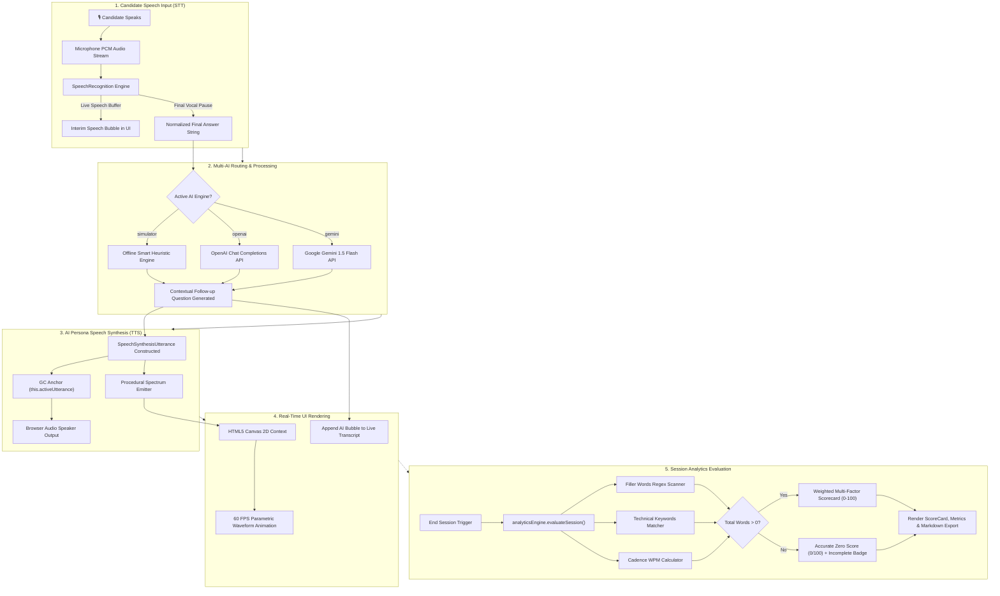

# 🏛️ ARCHITECTURE.md — End-to-End Architecture & Visual Pipeline Representation

> **A comprehensive visual reference detailing the InterviewAI Pro system architecture, end-to-end data pipelines, state machines, audio processing pipelines, and component hierarchy.**

---

## 📑 Table of Contents
1. [High-Level 3-Tier System Architecture](#1-high-level-3-tier-system-architecture)
2. [End-to-End Voice & Data Processing Pipeline](#2-end-to-end-voice--data-processing-pipeline)
3. [Audio State Machine Lifecycle](#3-audio-state-machine-lifecycle)
4. [AI Router & Multi-Engine Intelligence Layer](#4-ai-router--multi-engine-intelligence-layer)
5. [HTML5 Canvas 60 FPS Visualizer Pipeline](#5-html5-canvas-60-fps-visualizer-pipeline)
6. [Analytics & Scorecard Evaluation Engine](#6-analytics--scorecard-evaluation-engine)
7. [React Component Tree & Hierarchy](#7-react-component-tree--hierarchy)

---

## 1. High-Level 3-Tier System Architecture

```
┌───────────────────────────────────────────────────────────────────────────────────┐
│                           1. PRESENTATION / UI LAYER                              │
│                                                                                   │
│  ┌──────────────────────┐   ┌───────────────────────┐   ┌──────────────────────┐  │
│  │   1. Setup Wizard    │   │  2. Live Session Room │   │ 3. Scorecard Report  │  │
│  │  - StepJobInput      │   │  - StateIndicator     │   │  - ScoreCard         │  │
│  │  - StepPersona       │──>│  - AudioVisualizer    │──>│  - FillerWordsAnaly. │  │
│  │  - StepAudioConfig   │   │  - LiveTranscript     │   │  - QuestionBreakdown │  │
│  │                      │   │  - ControlToolbar     │   │  - ExportModal       │  │
│  └──────────────────────┘   └───────────────────────┘   └──────────────────────┘  │
└──────────────────────────────────────────┬────────────────────────────────────────┘
                                           │
                                    Event Actions /
                                    User Speech Audio
                                           │
                                           ▼
┌───────────────────────────────────────────────────────────────────────────────────┐
│                    2. AUDIO & AI ENGINE MIDDLEWARE LAYER                          │
│                                                                                   │
│  ┌─────────────────────────┐               ┌───────────────────────────────────┐  │
│  │ SpeechRecognitionService│               │      SpeechSynthesisService       │  │
│  │ (Web Speech API STT)    │               │      (Web Speech API TTS)         │  │
│  │ - Buffer Aggregator     │               │ - Active Utterance GC Anchor      │  │
│  │ - Continuous Stream     │               │ - Voice Bank & Accent Resolver    │  │
│  │ - Interim Preservation  │               │ - Procedural Frequency Emitter    │  │
│  └────────────┬────────────┘               └───────────────────▲───────────────┘  │
│               │                                                │                  │
│        Candidate Text                                   AI Next Question          │
│               │                                                │                  │
│               ▼                                                │                  │
│  ┌─────────────────────────────────────────────────────────────┴───────────────┐  │
│  │                         aiEngine (Multi-Router)                             │  │
│  │                                                                             │  │
│  │   ┌────────────────────────┐  ┌──────────────────┐  ┌──────────────────┐    │  │
│  │   │  Smart Heuristic Sim   │  │    OpenAI API    │  │    Gemini API    │    │  │
│  │   │ (Free / Offline Rules) │  │ (gpt-3.5 / 4o)   │  │ (gemini-1.5-fl.) │    │  │
│  │   └────────────────────────┘  └──────────────────┘  └──────────────────┘    │  │
│  └─────────────────────────────────────────────────────────────────────────────┘  │
└──────────────────────────────────────────┬────────────────────────────────────────┘
                                           │
                                   Transcript History &
                                     Session Telemetry
                                           │
                                           ▼
┌───────────────────────────────────────────────────────────────────────────────────┐
│                      3. ANALYTICS & EVALUATION LAYER                              │
│                                                                                   │
│  ┌─────────────────────────────────────────────────────────────────────────────┐  │
│  │                          analyticsEngine                                    │  │
│  │                                                                             │  │
│  │  • Regex Filler Word Counter (um, uh, like, basically, you know)            │  │
│  │  • Tech Terms Density Scanner (React, Docker, SQL, APIs, Kafka, etc.)       │  │
│  │  • Speech Cadence Calculator (Words Per Minute WPM)                         │  │
│  │  • Multi-factor Weighted Referee (Tech 40%, Comm 30%, Confidence 30%)      │  │
│  │  • Empty-Session Guard (Zero-Score validation for skipped sessions)         │  │
│  │  • Markdown Serializer for Instant Export & Clipboard Copy                  │  │
│  └─────────────────────────────────────────────────────────────────────────────┘  │
└───────────────────────────────────────────────────────────────────────────────────┘
```

---

## 2. End-to-End Voice & Data Processing Pipeline



---

## 3. Audio State Machine Lifecycle

The application operates as a deterministic finite-state automaton (FSM) transitioning through four explicit audio phases:

```
                          ┌───────────────────────────┐
                          │          STANDBY          │
                          │ (Cyan Ambient Breathing)  │
                          └─────────────┬─────────────┘
                                        │
                         Candidate clicks mic / speaks
                                        │
                                        ▼
                          ┌───────────────────────────┐
                          │         LISTENING         │
                          │ (Glowing Rose High-Bounce)│
                          └─────────────┬─────────────┘
                                        │
                       User clicks stop / speech finishes
                                        │
                                        ▼
                          ┌───────────────────────────┐
                          │         THINKING          │
                          │ (Amber Rhythmic Fast Wave)│
                          └─────────────┬─────────────┘
                                        │
                           AI completes question generation
                                        │
                                        ▼
                          ┌───────────────────────────┐
                          │         SPEAKING          │
                          │(Purple Smooth Pulse Wave) │
                          └─────────────┬─────────────┘
                                        │
                         Speech synthesis utterance ends
                                        │
                                        └─────────────────► (Returns to STANDBY)
```

### State Specifications:
| State | UI Color | Frequency | Amplitude | Meaning |
| :--- | :--- | :--- | :--- | :--- |
| **`standby`** | Cyan (`#00F2FE`) | Low (`0.04`) | Gentle (`15px`) | Idle state, waiting for candidate to initiate speech. |
| **`listening`** | Rose (`#F43F5E`) | Dynamic | High (`35-50px`) | Microphone stream open, recording and transcribing user voice. |
| **`thinking`** | Amber (`#F59E0B`) | Fast (`0.08`) | Tight (`12px`) | Speech stream closed, AI processing response and drafting follow-up. |
| **`speaking`** | Purple (`#7C3AED`) | Harmonic | Resonant (`25-40px`) | Browser speech synthesis reading persona question aloud. |

---

## 4. AI Router & Multi-Engine Intelligence Layer

The AI routing layer provides dual operational modes: **Zero-Setup Offline** for GitHub recruiters and reviewers, and **Direct Cloud API** for senior production evaluation:

```
                            ┌────────────────────────────────────┐
                            │    aiEngine.generateNextQuestion   │
                            └─────────────────┬──────────────────┘
                                              │
              ┌───────────────────────────────┼───────────────────────────────┐
              │                               │                               │
              ▼                               ▼                               ▼
    [Mode: 'simulator']              [Mode: 'openai']                [Mode: 'gemini']
              │                               │                               │
    • Predefined regex rules         • Validates sk-proj-...         • Validates AIzaSy...
    • STAR keyword analysis          • Formats messages array        • Calls Gemini 1.5 Flash
    • Technical term counting        • Calls /v1/chat/completions    • Restructures parts text
    • Dynamic follow-up bank         • Model: gpt-3.5-turbo          • Zero token duplication
              │                               │                               │
              │                               ▼                               │
              │                      (HTTP Failure / Rate Limit)              │
              │                               │                               │
              └───────────────────────────────┼───────────────────────────────┘
                                              │
                                              ▼
                             ┌─────────────────────────────────┐
                             │  Graceful Fallback to Simulator │
                             │  (Guarantees Zero App Freezes)  │
                             └─────────────────────────────────┘
```

---

## 5. HTML5 Canvas 60 FPS Visualizer Pipeline

Rather than manipulating hundreds of DOM `<div>` nodes (which triggers continuous browser reflows and layout recalculations), audio waves are rendered on a GPU-accelerated HTML5 `<canvas>` using parametric trigonometric physics:

```
For each frame (requestAnimationFrame):
  1. Clear Canvas: ctx.clearRect(0, 0, width, height)
  2. For wave w in [0, 1, 2]:
     - Set Stroke Color: RGBA with state-dependent hue and decreasing alpha
     - Compute Path:
       For x from 0 to canvas.width:
         • distance = |x - width/2| / (width/2)
         • envelope = cos(distance * π/2)            // Smooth taper at left/right edges
         • y = centerY + sin(x * freq + time * w) * amplitude * envelope
     - Stroke Path: ctx.stroke()
```

### Responsive Scaling Architecture:
- Canvas dimensions are coupled to the parent container's `clientWidth` via a `resizeCanvas()` hook.
- When the browser window is resized, the canvas resolution updates immediately to eliminate pixelation and maintain razor-sharp waveforms across Retina and 4K displays.

---

## 6. Analytics & Scorecard Evaluation Engine

```
[Candidate Transcript History]
              │
              ├──────────────────────────────┬──────────────────────────────┐
              ▼                              ▼                              ▼
    [Filler Words Matcher]        [Technical Keyword Match]      [Word Count & Cadence]
    Regex: \b(um|uh|like|          Regex: \b(react|node|api|     Total words spoken divided
    basically|you know)\b          docker|sql|system|...)\b      by time -> Cadence WPM
              │                              │                              │
              └──────────────────────────────┼──────────────────────────────┘
                                             │
                                             ▼
                                  {Total Words Spoken > 0?}
                                    /                 \
                                  (No)               (Yes)
                                  /                     \
                      ┌──────────────────────┐   ┌────────────────────────────────┐
                      │    Zero Guard Score  │   │  Multi-Factor Weighted Referee │
                      │  • Overall: 0 / 100  │   │  • Technical Depth (40%)       │
                      │  • Technical: 0 / 100│   │  • Communication Clarity (30%) │
                      │  • Comm: 0 / 100     │   │  • Confidence Rating (30%)     │
                      │  • Questions: 0 / 100│   │  • Question Scores: 40 - 98    │
                      │  • Badge: Incomplete │   │  • Badge: Evaluated            │
                      └──────────────────────┘   └────────────────────────────────┘
```

---

## 7. React Component Tree & Hierarchy

```
App.jsx (Top-level Router & Audio Lifecycle Orchestrator)
│
├── Navbar.jsx (Brand, Live AI Mode Badge, Key Settings Trigger, New Session)
│
├── [Step 1: Setup Wizard]
│   ├── StepJobInput.jsx (Preset Role Cards, Custom Job Title, Seniority, Description)
│   ├── StepPersona.jsx (Interviewer Cards: Vance, Chen, Jenkins, Miller)
│   └── StepAudioConfig.jsx (Mic Input Testing, STT Verification, TTS Accent Selection)
│
├── [Step 2: Live Interview Session]
│   ├── StateIndicator.jsx (High-contrast Reactive Pill Badge)
│   ├── AudioVisualizer.jsx (60 FPS Parametric Sine-Wave Canvas)
│   ├── LiveTranscript.jsx (Chat Feed, Persona Bubbles, Candidate Bubbles, Manual Input)
│   └── ControlToolbar.jsx (Mic Toggle Button, Hint Request, Skip Question, End Session)
│
├── [Step 3: Post-Interview Analytics]
│   ├── ScoreCard.jsx (Overall Score Ring, Technical/Comm/Confidence Sub-Cards)
│   ├── FillerWordsAnalysis.jsx (Pause Counter, Frequency Badges, Speech Cadence WPM)
│   └── QuestionBreakdown.jsx (Accordion Breakdown, Strengths, Growth Areas, STAR Model Answers)
│
└── Modals / Overlays
    ├── ApiSettingsModal.jsx (OpenAI & Gemini API Key Inputs)
    └── ExportModal.jsx (Formatted Markdown Exporter & Clipboard Integration)
```

